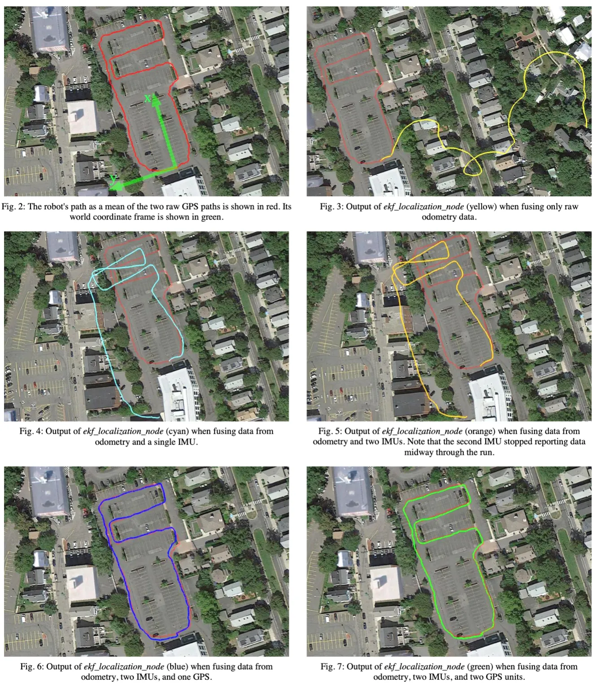

# Kalman Filter — The Gain and the Covariance

## 1. Why and how to use it

Why bother with a Kalman filter? Because one sensor alone can't locate a robot. In [1], a robot drove a loop around a parking lot, and the same data went through the EKF with different sensors. Odometry only: it ends 174 m off, in the houses next door. Add IMUs: still 40 to 47 m off. Add GPS: about 1 m.

<div style="text-align: center;">

</div>

*Fig. 2 to 7 from [1]. Red: reference path (mean of two GPS tracks). EKF with odometry only (yellow), + one IMU (cyan), + two IMUs (orange), + one GPS (blue), + two GPS (green).*

Start with the simplest case: measure one length with a ruler $k$ times. The best guess is the average, and the first $k-1$ readings already add up to $(k-1)\,\hat{x}\_{k-1}$, so you don't need to keep them:

$$
\begin{aligned}
\hat{x}_k &= \frac{1}{k}\big(z_1 + z_2 + \cdots + z_k\big) \qquad \text{(average)}\\
&= \frac{1}{k}\big(z_1 + \cdots + z_{k-1}\big) + \frac{1}{k}z_k = \frac{k-1}{k}\,\hat{x}_{k-1} + \frac{1}{k}z_k\\
&= \hat{x}_{k-1} + \frac{1}{k}\big(z_k - \hat{x}_{k-1}\big) \qquad \text{(recursive)}
\end{aligned}
$$

Here $z$ is the sensor reading and $\hat{x}$ is our estimate. In general form:

$$
\underbrace{\hat{x}_k}_{\text{current estimate}} = \underbrace{\hat{x}_{k-1}}_{\text{last estimate}} + K_k\,\big(\underbrace{z_k}_{\text{current measurement}} - \underbrace{\hat{x}_{k-1}}_{\text{last estimate}}\big).
$$

$K\_k$ is the Kalman gain. For the average it is $\frac{1}{k}$. The Kalman filter instead compares the estimate error with the measurement error (see Section 2):

$$
K_k = \frac{e_{EST,k-1}}{e_{EST,k-1} + e_{MEA,k}}.
$$

If $e\_{EST,k-1} \gg e\_{MEA,k}$, the old estimate is bad, so $K\_k \approx 1$ and $\hat{x}\_k \approx z\_k$. If $e\_{EST,k-1} \ll e\_{MEA,k}$, it is good, so $K\_k \approx 0$ and $\hat{x}\_k \approx \hat{x}\_{k-1}$. So every new reading takes three steps:

$$
\begin{aligned}
&\text{Step 1} && K_k = \frac{e_{EST,k-1}}{e_{EST,k-1} + e_{MEA,k}} && \text{(Kalman gain)}\\
&\text{Step 2} && \hat{x}_k = \hat{x}_{k-1} + K_k\big(z_k - \hat{x}_{k-1}\big) && \text{(estimate)}\\
&\text{Step 3} && e_{EST,k} = (1 - K_k)\,e_{EST,k-1} && \text{(estimate error)}
\end{aligned}
$$

Note that Step 3 updates the error, not the estimate, because Step 1 needs it next round ($e\_{MEA}$ comes from the sensor). Since $K\_k < 1$, the error and the next gain keep shrinking. What's left: where does $K\_k$ come from, and how do you compute it?

## 2. Finding $K\_k$ with the covariance

To find $K\_k$, we need the covariance of the estimate error $e\_k = x\_k - \hat{x}\_k$:

$$
P_k = E\big[e_ke_k^\top\big].
$$

We want the error small, so we minimize its trace $\mathrm{tr}(P\_k)$. Why a covariance? Because $e\_k$ is a vector. With two components:

$$
\begin{gathered}
P_k = E\left[\begin{bmatrix} e_1 \\ e_2 \end{bmatrix}\begin{bmatrix} e_1 & e_2 \end{bmatrix}\right] = \begin{bmatrix} E[e_1^2] & E[e_1e_2] \\ E[e_2e_1] & E[e_2^2] \end{bmatrix},\\
\mathrm{tr}(P_k) = E[e_1^2] + E[e_2^2].
\end{gathered}
$$

The diagonal holds each component's squared error, so the trace is the total squared error. **The covariance matrix is only a measuring tool; there is nothing special about it.**

We skip the derivation. Just remember: $K\_k$ is what we solve for, and $P\_k$ is what we make small. Now swap the errors of Section 1 for covariances: $e\_{EST}$ becomes $P$, and $e\_{MEA}$ becomes $R = E\big[v\_kv\_k^\top\big]$, where $v\_k = z\_k - x\_k$ is one measurement's error. For the ruler, $R$ is the variance of one reading:

$$
\begin{aligned}
&\text{Step 1} && K_k = P_{k-1}\big(P_{k-1} + R\big)^{-1} && \text{(Kalman gain)}\\
&\text{Step 2} && \hat{x}_k = \hat{x}_{k-1} + K_k\big(z_k - \hat{x}_{k-1}\big) && \text{(estimate)}\\
&\text{Step 3} && P_k = (I - K_k)\,P_{k-1} && \text{(error covariance)}
\end{aligned}
$$

$R$ comes from the sensor and $P$ starts at $P\_0$, so everything is known. With one variable the inverse is a division, $K\_k = P\_{k-1}/(P\_{k-1} + R)$, the formula from Section 1.

Check that it gives the average: start with $\hat{x}\_1 = z\_1$, so $P\_1 = R$. Then $K\_2 = R/(R + R) = 1/2$, $P\_2 = R/2$, $K\_3 = 1/3$, $P\_3 = R/3$, and in general $K\_k = 1/k$, $P\_k = R/k$. So averaging is a Kalman filter on a fixed quantity, and $P\_k = R/k$ is why more readings help.

These steps are a special case of eqs. (5) to (7) in [1], which `robot_localization` runs. The paper adds two things. A sensor often measures only part of the state, so $z = Hx$, with $H$ picking the measured part. A ruler measures all of it, so $H = I$. And a car moves between readings, so the paper first predicts the covariance forward, $\hat{P}\_k$. A ruler doesn't move, so $\hat{P}\_k = P\_{k-1}$. Plug both in:

| | Paper [1], general case | Section 2, with $H = I$ and $\hat{P}\_k = P\_{k-1}$ |
|---|---|---|
| Step 1, gain, eq. (5) | $K = \hat{P}\_kH^\top\big(H\hat{P}\_kH^\top + R\big)^{-1}$ | $K\_k = P\_{k-1}\big(P\_{k-1} + R\big)^{-1}$ |
| Step 2, estimate, eq. (6) | $x\_k = \hat{x}\_k + K\big(z - H\hat{x}\_k\big)$ | $\hat{x}\_k = \hat{x}\_{k-1} + K\_k\big(z\_k - \hat{x}\_{k-1}\big)$ |
| Step 3, error covariance, eq. (7) | $P\_k = (I - KH)\hat{P}\_k(I - KH)^\top + KRK^\top$ | $P\_k = (I - K\_k)\,P\_{k-1}$ |

Note that in the paper a hat means *predicted*, here it means *estimated*. Row 3 is a longer form. With the exact optimal $K$ both give the same $P\_k$, but rounding means $K$ is never exact, and the long form keeps $P\_k$ "positive semi-definite" [1].

## 3. The three steps in ekf.cpp

The three steps live in `correct()` of `ekf.cpp`. Before that, `preparePose`, `prepareTwist` and `prepareAcceleration` in `ros_filter.cpp` convert each sensor message into the filter's frame and copy its covariance in as $R$. So $R$ is only as good as what the sensor driver reports. In [1], odometry and IMU were noisier than reported, which is partly why the filter's position variance came out far smaller than its true error.

In `correct()`, `estimateErrorCovariance_` is $P$ (already predicted to $\hat{P}\_k$), `measurementCovarianceSubset` is $R$, `stateToMeasurementSubset` is $H$, `kalmanGainSubset` is $K$, and `state_` is $\hat{x}$. $H$ is just a selector. Say the state is position, velocity and acceleration, and the sensor measures only velocity:

$$
x = \begin{bmatrix} \text{position} \\ \text{velocity} \\ \text{acceleration} \end{bmatrix}, \qquad H = \begin{bmatrix} 0 & 1 & 0 \end{bmatrix}, \qquad H^\top = \begin{bmatrix} 0 \\ 1 \\ 0 \end{bmatrix},
$$

so $Hx$ is the predicted velocity. The code puts a 1 in each measured variable's column, and gets $H^\top$ with `.transpose()`:

```cpp
// H: one row per measured variable, a 1 in that variable's column
stateToMeasurementSubset(i, updateIndices[i]) = 1;

// Step 1, eq. (5): K = P H^T (H P H^T + R)^-1
Eigen::MatrixXd pht = estimateErrorCovariance_ * stateToMeasurementSubset.transpose();
Eigen::MatrixXd hphrInv =
    (stateToMeasurementSubset * pht + measurementCovarianceSubset).inverse();
kalmanGainSubset.noalias() = pht * hphrInv;

// Step 2, eq. (6): x = x + K (z - H x)
innovationSubset = (measurementSubset - stateSubset);
state_.noalias() += kalmanGainSubset * innovationSubset;

// Step 3, eq. (7): P = (I - K H) P (I - K H)^T + K R K^T
Eigen::MatrixXd gainResidual = identity_;
gainResidual.noalias() -= kalmanGainSubset * stateToMeasurementSubset;
estimateErrorCovariance_ = gainResidual * estimateErrorCovariance_ * gainResidual.transpose();
estimateErrorCovariance_.noalias() += kalmanGainSubset *
                                      measurementCovarianceSubset *
                                      kalmanGainSubset.transpose();
```

`pht` is $PH^\top$ and `hphrInv` is $(HPH^\top + R)^{-1}$, so Step 1 is eq. (5). `stateSubset` is $H\hat{x}\_k$, so `innovationSubset` is $z - H\hat{x}\_k$. Before Step 2, the code wraps angle differences into $[-\pi, \pi]$ and skips measurements too far from the prediction (a Mahalanobis distance check). Step 3 is the long form (7), with `gainResidual` as $I - KH$.

## References

[1] T. Moore and D. Stouch, "A Generalized Extended Kalman Filter Implementation for the Robot Operating System," in *Intelligent Autonomous Systems 13 (IAS-13)*, Advances in Intelligent Systems and Computing, vol. 302, Springer, 2014, pp. 335–348. [doi:10.1007/978-3-319-08338-4_25](https://doi.org/10.1007/978-3-319-08338-4_25)
