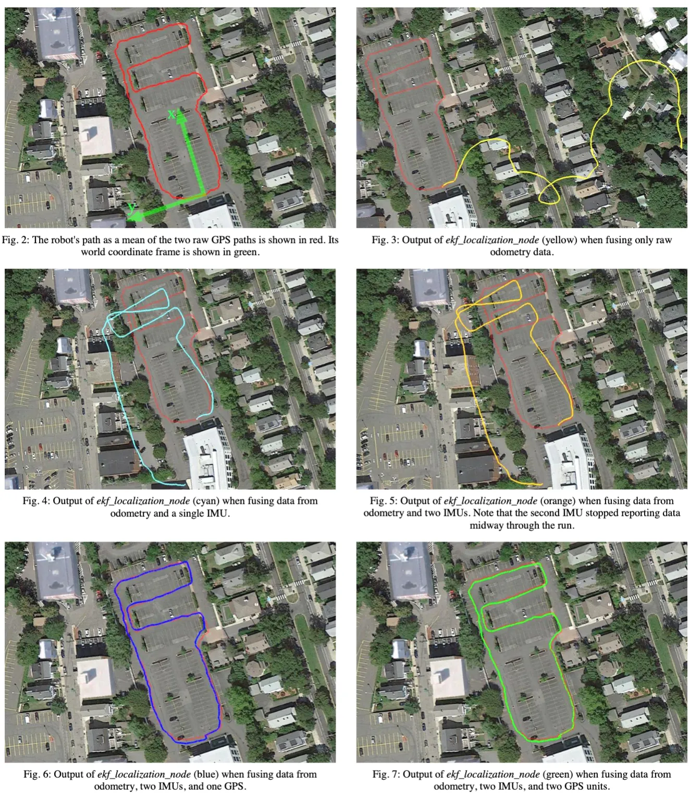

# Kalman Filter, Part 2 — The Gain and the Covariance

## 1. Why and how to use it

The Kalman filter exists because no single source of data can locate a robot well. The paper that introduced `robot_localization` [1] shows this in one experiment. A Pioneer 3 robot drove a loop around a parking lot and came back to where it started, and the same recorded data were run through the EKF with five different sets of sensors. With wheel odometry alone (Fig. 3, yellow), the estimated path leaves the parking lot and wanders through the houses next to it, and the final position is more than 174 m from the start, because the robot's biased wheel encoders report every straight line as a mild right turn. Adding one IMU (Fig. 4) or two (Fig. 5) keeps the path near the lot, but the end point is still 40 to 47 m off in $y$. Only when GPS is fused as well (Fig. 6 and Fig. 7) does the estimate follow the GPS track, and the loop-closure error drops to about 1 m.

<div style="text-align: center;">

</div>

*Fig. 2 to Fig. 7 from Moore and Stouch [1]. Red is the robot's path as the mean of two raw GPS tracks. The EKF fuses odometry only (yellow), odometry and one IMU (cyan), odometry and two IMUs (orange, the second IMU stopped midway), then adds one GPS (blue) or two GPS units (green).*

The simplest case of this filtering is estimating one fixed quantity from repeated measurements. If a ruler is read $k$ times, giving the measurements $z_1, \dots, z_k$, the natural estimate $\hat{x}_k$ of the true length is their average. It can be computed recursively, because the sum of the first $k-1$ measurements is already contained in the last estimate as $(k-1)\,\hat{x}_{k-1}$:

$$
\begin{aligned}
\hat{x}_k &= \frac{1}{k}\big(z_1 + z_2 + \cdots + z_k\big) && \text{(average of } k \text{ measurements)}\\
&= \frac{1}{k}\big(z_1 + \cdots + z_{k-1}\big) + \frac{1}{k}z_k = \frac{k-1}{k}\,\hat{x}_{k-1} + \frac{1}{k}z_k\\
&= \hat{x}_{k-1} + \frac{1}{k}\big(z_k - \hat{x}_{k-1}\big) && \text{(recursive form)}
\end{aligned}
$$

Throughout, $z$ is a measurement, read directly from the sensor, and $\hat{x}$ is an estimate, computed by the filter. Abstracting the last line gives

$$
\underbrace{\hat{x}_k}_{\text{current estimate}} = \underbrace{\hat{x}_{k-1}}_{\text{last estimate}} + K_k\,\big(\underbrace{z_k}_{\text{current measurement}} - \underbrace{\hat{x}_{k-1}}_{\text{last estimate}}\big),
$$

where the coefficient $K_k$ is the Kalman gain. In the average it is $\frac{1}{k}$, which depends only on how many measurements have arrived. The Kalman filter instead computes it from the error of the last estimate, $e_{EST,k-1}$, and the error of the current measurement, $e_{MEA,k}$:

$$
K_k = \frac{e_{EST,k-1}}{e_{EST,k-1} + e_{MEA,k}},
$$

which comes from Section 2. The two extreme cases show how it works. If $e_{EST,k-1} \gg e_{MEA,k}$, the last estimate is inaccurate, so $K_k \approx 1$ and the current estimate equals the current measurement, $\hat{x}_k \approx z_k$. If $e_{EST,k-1} \ll e_{MEA,k}$, the last estimate is accurate, so $K_k \approx 0$ and the current estimate stays at the last estimate, $\hat{x}_k \approx \hat{x}_{k-1}$.

Using the filter therefore takes three steps, repeated for every new measurement:

$$
\begin{aligned}
&\text{Step 1} && K_k = \frac{e_{EST,k-1}}{e_{EST,k-1} + e_{MEA,k}} && \text{(Kalman gain)}\\
&\text{Step 2} && \hat{x}_k = \hat{x}_{k-1} + K_k\big(z_k - \hat{x}_{k-1}\big) && \text{(estimate)}\\
&\text{Step 3} && e_{EST,k} = (1 - K_k)\,e_{EST,k-1} && \text{(estimate error)}
\end{aligned}
$$

Step 3 updates the error of the estimate, not the estimate itself, which Step 2 has already done. The next round needs this error, because Step 1 at time $k+1$ uses $e_{EST,k}$, while the measurement error $e_{MEA}$ comes from the sensor and needs no update. Running the three steps shows that the gain gets smaller and smaller, and so does the estimate error. The reason is in the formulas themselves. The gain is always less than 1, so Step 3 makes the estimate error shrink, and a smaller estimate error makes the next gain smaller through Step 1. What is still unclear is how $K_k$ is found, and how it is actually computed at each step.

## 2. Finding $K_k$ with the covariance

The gain $K_k$ has to be found, and finding it requires the covariance of the estimate error. With the estimate error defined as $e_k = x_k - \hat{x}_k$, the covariance in its simplest form is

$$
P_k = E\big[e_ke_k^\top\big].
$$

We want the estimate to be close to the true value, so the error should be small, which means minimizing the covariance of the error, and specifically its trace $\mathrm{tr}(P_k)$.

Why this quantity is a covariance, and why its trace is the thing to minimize, follows from $e_k$ being a vector. For a state with two components, $e_k = [e_1,\ e_2]^\top$ and

$$
P_k = E\left[\begin{bmatrix} e_1 \\ e_2 \end{bmatrix}\begin{bmatrix} e_1 & e_2 \end{bmatrix}\right] = \begin{bmatrix} E[e_1^2] & E[e_1e_2] \\ E[e_2e_1] & E[e_2^2] \end{bmatrix}, \qquad \mathrm{tr}(P_k) = E[e_1^2] + E[e_2^2],
$$

which is exactly the covariance matrix of the error. Its diagonal holds the squared error of each component, so the trace is the total squared error, and minimizing $\mathrm{tr}(P_k)$ makes every component of the error small. **The covariance matrix is only a measuring tool; there is nothing special about it.**

The derivation that minimizes $\mathrm{tr}(P_k)$ over $K_k$ is skipped here. What matters is the roles: $K_k$ is the parameter we solve for, and $P_k$ is the matrix we want to make as small as possible. Minimizing it turns the three steps of Section 1 into a computation, with $P$ in place of the estimate error $e_{EST}$ and the covariance $R$ of the measurement noise in place of the measurement error $e_{MEA}$. For a fixed state that the sensor measures directly, as in the ruler example, each step is computed as

$$
\begin{aligned}
&\text{Step 1} && K_k = P_{k-1}\big(P_{k-1} + R\big)^{-1} && \text{(Kalman gain)}\\
&\text{Step 2} && \hat{x}_k = \hat{x}_{k-1} + K_k\big(z_k - \hat{x}_{k-1}\big) && \text{(estimate)}\\
&\text{Step 3} && P_k = (I - K_k)\,P_{k-1} && \text{(error covariance)}
\end{aligned}
$$

$R$ comes from the sensor, and $P$ starts from an initial value $P_0$ and is then kept up to date by Step 3, so every quantity needed for $K_k$ is known at each step. For one variable the inverse becomes a division, $K_k = P_{k-1}/(P_{k-1} + R)$, which is the formula from Section 1.

This also brings back the average from the start of Section 1. Take the first reading as the first estimate, $\hat{x}_1 = z_1$, so its error covariance is that of one reading, $P_1 = R$. Step 1 then gives $K_2 = R/(R + R) = 1/2$, and Step 3 gives $P_2 = R/2$. The next round gives $K_3 = (R/2)/(R/2 + R) = 1/3$ and $P_3 = R/3$, and in general $K_k = 1/k$ and $P_k = R/k$. The average is therefore exactly what the Kalman filter computes for a fixed quantity measured by a sensor of constant accuracy, and $P_k = R/k$ is why averaging more readings gives a better estimate.

The three steps are a special case of the equations that `robot_localization` actually runs, equations (5) to (7) of [1]. The paper adds two things. First, a sensor usually measures only part of the state, for example wheel odometry measures velocity but not position, so the measurement is written $z = Hx$, where the matrix $H$ picks out the measured part. A ruler measures the length directly, so $H = I$. Second, a car keeps moving between measurements, so before each correction the paper predicts the state and its covariance one step forward with the motion model, and writes the predicted covariance as $\hat{P}_k$. A ruler does not move, so the prediction is just the last value, $\hat{P}_k = P_{k-1}$. Setting $H = I$ and $\hat{P}_k = P_{k-1}$ turns each equation of the paper into one of our steps:

| | Paper [1], general case | Section 2, with $H = I$ and $\hat{P}_k = P_{k-1}$ |
|---|---|---|
| Step 1, gain, eq. (5) | $K = \hat{P}_kH^\top\big(H\hat{P}_kH^\top + R\big)^{-1}$ | $K_k = P_{k-1}\big(P_{k-1} + R\big)^{-1}$ |
| Step 2, estimate, eq. (6) | $x_k = \hat{x}_k + K\big(z - H\hat{x}_k\big)$ | $\hat{x}_k = \hat{x}_{k-1} + K_k\big(z_k - \hat{x}_{k-1}\big)$ |
| Step 3, error covariance, eq. (7) | $P_k = (I - KH)\hat{P}_k(I - KH)^\top + KRK^\top$ | $P_k = (I - K_k)\,P_{k-1}$ |

In the paper a hat marks a predicted value, so its $\hat{x}_k$ is the last estimate moved forward by the model, while in this post a hat marks any estimate. The third row looks different because the paper keeps a longer form of Step 3. When $K$ is exactly the optimal gain, the two forms give the same $P_k$. The paper uses the long one because rounding errors keep $K$ from ever being exactly optimal, and the long form keeps $P_k$ a valid covariance "by ensuring that $P_k$ remains positive semi-definite" [1]. Computing the three steps is therefore computing (5) to (7) for a sensor that measures the whole state of something that does not move.

## 3. The three steps in ekf.cpp

In `robot_localization` the three steps live in the `correct()` function of `ekf.cpp`. Before a measurement reaches it, `ros_filter.cpp` has already converted the sensor message into the frame the filter works in, in `preparePose`, `prepareTwist` and `prepareAcceleration`. Inside `correct()`, `estimateErrorCovariance_` is $P$, `measurementCovarianceSubset` is $R$, `stateToMeasurementSubset` is $H$, `kalmanGainSubset` is $K$, and `state_` is the state estimate. At this point `estimateErrorCovariance_` holds the predicted covariance $\hat{P}_k$, because `predict()` has just moved it forward.

The code never computes $H^\top$ as a separate sensor model. It builds $H$ from the list of state variables the sensor measures and then transposes it. Take a state with only three variables, position, velocity and acceleration, and a sensor that reports only velocity. $H$ then selects the second variable,

$$
x = \begin{bmatrix} \text{position} \\ \text{velocity} \\ \text{acceleration} \end{bmatrix}, \qquad H = \begin{bmatrix} 0 & 1 & 0 \end{bmatrix}, \qquad H^\top = \begin{bmatrix} 0 \\ 1 \\ 0 \end{bmatrix},
$$

so $Hx$ is the predicted velocity, which can be compared directly with the measured one. The code builds $H$ the same way, putting a single 1 in the column of each measured variable, and gets $H^\top$ from Eigen's `.transpose()`:

```cpp
// H: one row per measured variable, a 1 in that variable's column
stateToMeasurementSubset(i, updateIndices[i]) = 1;

// Step 1, eq. (5): K = P H^T (H P H^T + R)^-1
Eigen::MatrixXd pht = estimateErrorCovariance_ * stateToMeasurementSubset.transpose();
Eigen::MatrixXd hphrInv =
    (stateToMeasurementSubset * pht + measurementCovarianceSubset).inverse();
kalmanGainSubset.noalias() = pht * hphrInv;

// Step 2, eq. (6): x = x + K (z - H x)
innovationSubset = (measurementSubset - stateSubset);
state_.noalias() += kalmanGainSubset * innovationSubset;

// Step 3, eq. (7): P = (I - K H) P (I - K H)^T + K R K^T
Eigen::MatrixXd gainResidual = identity_;
gainResidual.noalias() -= kalmanGainSubset * stateToMeasurementSubset;
estimateErrorCovariance_ = gainResidual * estimateErrorCovariance_ * gainResidual.transpose();
estimateErrorCovariance_.noalias() += kalmanGainSubset *
                                      measurementCovarianceSubset *
                                      kalmanGainSubset.transpose();
```

In Step 1, `pht` is $PH^\top$ and `hphrInv` is $(HPH^\top + R)^{-1}$, so their product is equation (5) written term by term. In Step 2, `stateSubset` holds the predicted values of the measured variables, which is $H\hat{x}_k$, so `innovationSubset` is the difference between the measurement and the prediction, $z - H\hat{x}_k$. Between computing it and updating the state, the code wraps angle differences into $[-\pi, \pi]$ and skips the update entirely if the measurement lies too far from the prediction under a Mahalanobis distance threshold. Step 3 is the long form (7) from the table above, with `gainResidual` as $I - KH$.

## References

[1] T. Moore and D. Stouch, "A Generalized Extended Kalman Filter Implementation for the Robot Operating System," in *Intelligent Autonomous Systems 13 (IAS-13)*, Advances in Intelligent Systems and Computing, vol. 302, Springer, 2014, pp. 335–348. [doi:10.1007/978-3-319-08338-4_25](https://doi.org/10.1007/978-3-319-08338-4_25)
